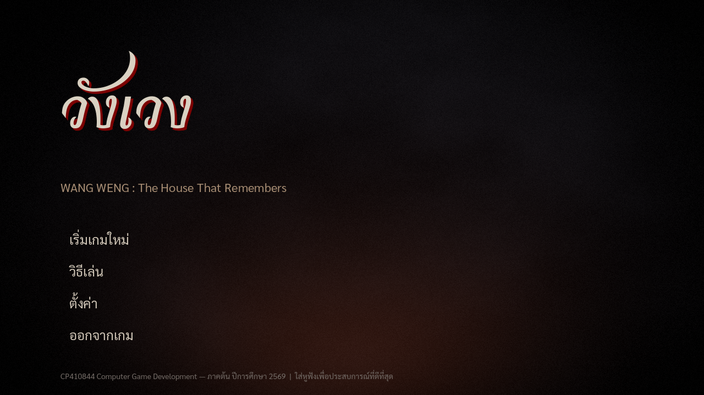

# วังเวง · WANG WENG
### The House That Remembers

เกมสยองขวัญสำรวจบ้านเก่า มุมมองบุคคลที่หนึ่ง — หนี หลบ ไขปริศนา ไม่มีการต่อสู้

### ▶ [เล่นออนไลน์บนเบราว์เซอร์](https://nattapongsric-collab.github.io/WangWeng/)

---

## เนื้อเรื่อง

"ข้าวฟาง" อายุ 21 ปี เดินทางกลับบ้านเก่าของตระกูลในต่างจังหวัด หลังยายที่เลี้ยงดูมาเสียชีวิต เพื่อจัดการมรดกและขายบ้าน
แต่เมื่อเข้าไปในบ้าน ประตูกลับปิดล็อกเอง ไฟฟ้าดับ และเริ่มได้ยินเสียงกระซิบที่คุ้นเคย
เขาต้องสำรวจบ้านทีละห้อง ไขปริศนาที่ซ่อนอยู่ในข้าวของส่วนตัวของยาย เพื่อค้นหาความจริงเกี่ยวกับ **"คำสาปของตระกูล"**
ที่ทำให้ทุกคนที่เกิดในบ้านหลังนี้ต้องกลับมา "ใช้หนี้" บางอย่างก่อนตาย — โดยมี **แม่หญิงชุดขาว** ผีผู้พิทักษ์บ้าน คอยไล่ตามเมื่อเขาทำเสียงดังหรือเข้าเขตต้องห้าม

## วิธีเล่น

| ปุ่ม | การทำงาน |
|---|---|
| **W A S D** | เดิน |
| **Shift** | วิ่ง (เสียงดัง ดึงดูดผี) |
| **Ctrl / C** | ย่อตัว (เงียบ มองเห็นยากขึ้น) |
| **F / คลิกขวา** | ไฟฉาย (เปิดนานเกินไปแสงจะดึงดูดผี) |
| **E / คลิกซ้าย** | โต้ตอบ เก็บของ ซ่อนตัว ออกจากที่ซ่อน |
| **Space (ค้าง)** | กลั้นหายใจตอนซ่อน |
| **Tab / J** | สมุดบันทึก (ของที่มี + อ่านจดหมายซ้ำ) |
| **Esc / P** | หยุดเกม ตั้งค่าความไวเมาส์และระดับเสียง |

**เคล็ดลับ**
- ผีได้ยินเสียงวิ่ง เสียงชนของ และเสียงเปิดประตู — ย่อตัวเดินเมื่อเธออยู่ใกล้
- หลบเข้าตู้เสื้อผ้าหรือใต้เตียงเมื่อถูกไล่ แต่อย่าให้เธอเห็นตอนมุดเข้าไป แล้วกด Space กลั้นหายใจเมื่อเธอเดินผ่านใกล้ ๆ
- อยู่ในที่มืดนานสติจะลด จะเห็นภาพหลอน — หาแสงเทียนหรือเปิดไฟฉาย
- ห้องพระที่จุดเทียนไว้ผีเข้าไม่ได้

## ระบบเกม

- **Stealth** — เสียงฝีเท้า (วิ่ง 12 ม. / เดิน 3.5 ม. / ย่อ 0), ชนของ, ไฟฉายร้อนเกิน ดึงดูดผี
- **ผี AI** — ลาดตระเวน → ตรวจเสียง → ไล่ล่า → ค้นหา; เห็นจากกรวยสายตา ได้ยินจากรัศมีเสียง
- **ซ่อนตัว + กลั้นหายใจ** — ตู้เสื้อผ้า 7 จุด เตียง 2 จุด
- **Sanity (สติ)** — มืดนาน/เห็นผี สติลด → กระซิบ เงาผู้หญิง เสียงเคาะ ภาพหลอน; ใกล้เทียนสติฟื้น
- **ปริศนา** — กุญแจ จดหมาย เศษรูปถ่าย 3 ชิ้น วางที่โต๊ะหมู่
- **บ้านที่เปลี่ยนแปลง** — 3 บท *เธอตื่นแล้ว → บ้านจำได้ → ทวงหนี้* ทางเดินเปลี่ยน เทียนดับทั้งบ้าน
- **ฉากจบ 2 แบบ** — หนีออกประตูหน้า หรือจุดเทียนแล้วเผาสัญญา (จบแท้)
- **Sound design** — เสียงเดินจริง เสียงบ้าน กระซิบ หัวใจเต้น ลมหายใจผี เหตุการณ์เสียงสุ่ม

## เล่นบนเครื่อง / พัฒนาต่อ

1. ติดตั้ง [Godot 4.7](https://godotengine.org/download)
2. `git clone https://github.com/nattapongsric-collab/WangWeng.git`
3. เปิด Godot → **Import** → เลือก `project.godot` → กด **F5**

โปรเจกต์ใช้เรนเดอร์ **GL Compatibility** จึงรันได้บนการ์ดจอทั่วไป และส่งออกเป็นเว็บได้
รายละเอียดเชิงเทคนิค (โครงสร้างโปรเจกต์ ปรับความยาก ทดสอบอัตโนมัติ บันทึกการแก้บัค) อยู่ใน [DEV_NOTES.md](DEV_NOTES.md)

### อัปเดตเวอร์ชันเว็บ

Godot → Project → Export → **Web** → ส่งออกไปที่ `docs/index.html` แล้ว commit/push
(หรือ `godot --headless --path . --export-release "Web" docs/index.html`)
เปิดใช้ GitHub Pages ที่ Settings → Pages → Deploy from a branch → `main` / `/docs`

## ทีมผู้จัดทำ

สาขาวิชาปัญญาประดิษฐ์

| รหัสนักศึกษา | ชื่อ |
|---|---|
| 673380440-6 | นายณัฐพงษ์ ศรีเชียงสา |
| 673380437-5 | นายจิตติพัฒน์ มูลศรี |
| 673380630-1 | นายธนโชติ กมลเลิศ |
| 673380636-9 | นางสาวภูริชญา โมรา |

## เครดิตและลิขสิทธิ์

- เอนจิน: [Godot Engine](https://godotengine.org) (MIT)
- เสียงเดิน เสียงประตู: [Kenney](https://kenney.nl) *Impact Sounds* และ *RPG Audio* (CC0)
- ฟอนต์: Sarabun และ Charmonman (SIL Open Font License)
- Texture โมเดล และเสียงอื่น ๆ สร้างขึ้นเองด้วยโค้ดภายในโปรเจกต์
